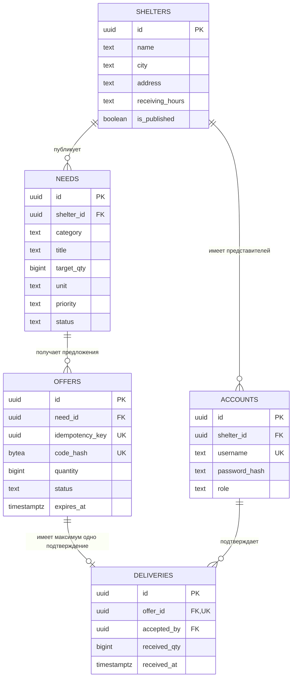

# Лапа рядом — модель данных MVP

**Документ:** `03_DATA_MODEL.md`  
**Версия:** 0.1 (рабочая схема)  
**Дата:** 21 октября 2026 года  
**Основание:** `00_PROJECT_CONCEPT.md`, `01_PRODUCT_REQUIREMENTS.md`, `02_USER_FLOWS.md`  
**Назначение:** логическая и физическая схема данных, правила целостности, транзакции, запросы и проверки миграции  
**Целевая СУБД:** Digital Q.DataBase; исходная для проверяемой миграции — PostgreSQL  
**Статус:** проектная спецификация; SQL ещё **не выполнялся** на конкретном экземпляре Digital Q.DataBase

## 1. Главные решения

1. **Пять основных таблиц:** `shelters`, `accounts`, `needs`, `offers`, `deliveries`. Никаких платёжных и пользовательских профилей добровольцев.
2. **Каждое предложение относится ровно к одной потребности** и резервирует указанное целое положительное количество на 7 суток.
3. **Одна передача — одно подтверждение.** Для одного предложения существует максимум одна запись в `deliveries`; при частичной передаче разница немедленно освобождается. Повторной поставки по этому же предложению в MVP нет.
4. **Итоговые количества не храним отдельными полями.** `received_qty` вычисляется как сумма подтверждённых передач; `reserved_qty` — как сумма ещё действующих резервирований; `available_qty = target_qty - received_qty - reserved_qty`.
5. **Все изменения количества сериализуются по строке потребности:** транзакция блокирует `shelters`, затем `needs`, после чего читает или меняет зависимые строки. Единый порядок `shelters → needs → offers` предотвращает гонки с публикацией/скрытием приюта и взаимные блокировки.
6. **Просроченное резервирование перестаёт учитываться по времени**, даже если запись ещё физически имеет статус `reserved`. Отдельный процесс изменения статусов не требуется для правильного остатка.
7. **Секретный код предложения не хранится в открытом виде.** В БД находится только его криптографический хеш; повтор безопасного запроса оговорён отдельно.
8. **Публичный список приютов — только опубликованные записи.** Доступ представителя к данным другого приюта запрещается сервером, независимо от интерфейса.
9. **UUID создаёт приложение**, чтобы не зависеть от расширений или встроенных генераторов СУБД; таблицы используют общие SQL-типы и ограничения.

Модель исходит из инвариантов BR-04—08 и требований FR-001—033 из `01_PRODUCT_REQUIREMENTS.md`. Открытые технические решения отмечены в §14.

## 2. Схема связей



`accounts.shelter_id` обязательно у роли `shelter_rep` и отсутствует у `admin`. У одного приюта допускается несколько представителей; каждый представитель в MVP относится к одному приюту.

## 3. Словарь сущностей

### 3.1. `shelters` — приюты

| Поле | Тип | Обязательность / правило |
|---|---|---|
| `id` | `UUID` | PK; генерирует сервер приложения |
| `name` | `TEXT` | Название, непустое |
| `city` | `TEXT` | Населённый пункт, непустой |
| `description` | `TEXT` | Может быть `NULL` |
| `address` | `TEXT` | Публичное место передачи, непустое |
| `receiving_hours` | `TEXT` | Публичные часы приёма, непустые; пока свободный текст |
| `is_published` | `BOOLEAN` | `FALSE` по умолчанию |
| `created_at`, `updated_at` | `TIMESTAMPTZ` | Служебное время |

Приют не удаляется при скрытии: меняется `is_published`. Публикация не означает автоматическую верификацию реального приюта — в MVP всё демонстрационное.

### 3.2. `accounts` — представители и администратор

| Поле | Тип | Обязательность / правило |
|---|---|---|
| `id` | `UUID` | PK |
| `username` | `TEXT` | Уникальный нормализованный логин |
| `password_hash` | `TEXT` | Результат стойкого алгоритма хеширования паролей (Argon2id либо эквивалент по принятой архитектуре) |
| `role` | `TEXT` | `admin` или `shelter_rep` |
| `shelter_id` | `UUID` | FK на `shelters` для представителя; `NULL` для администратора |
| `is_active` | `BOOLEAN` | Признак разрешённого входа |
| `created_at`, `updated_at` | `TIMESTAMPTZ` | Служебное время |

Один и тот же логин не должен дублироваться разным регистром; сервер приводит его к нижнему регистру. Пароли в исходном виде, контакты добровольцев и сессионные токены **не сохраняются** в данной предметной схеме. Хранение и отзыв серверных сессий — вопрос архитектуры; допустимо отдельное защищённое хранилище/таблица.

### 3.3. `needs` — потребности приютов

| Поле | Тип | Обязательность / правило |
|---|---|---|
| `id` | `UUID` | PK |
| `shelter_id` | `UUID` | FK, приют-владелец |
| `category` | `TEXT` | Значение из закрытого справочника |
| `title` | `TEXT` | Название, непустое |
| `details` | `TEXT` | Необязательное уточнение |
| `target_qty` | `BIGINT` | `> 0`; только целое |
| `unit` | `TEXT` | `piece`, `pack`, `kg` |
| `priority` | `TEXT` | `normal` либо `urgent` |
| `status` | `TEXT` | `active`, `fulfilled`, `closed` |
| `created_at`, `updated_at` | `TIMESTAMPTZ` | Служебное время |

Категории: `food` (корм), `hygiene` (наполнитель и гигиена), `textile` (лежанки и текстиль), `equipment` (миски и инвентарь), `carriers` (переноски и амуниция), `other` (прочее). Отображаемые русские названия определяет UI, а не БД.

Единицу измерения после создания **не меняем**. `target_qty` для активной потребности можно увеличить или уменьшить, но не ниже суммы подтверждённой и реально действующей обещанной помощи. В терминальных состояниях редактирование/возобновление через MVP-интерфейс запрещено.

### 3.4. `offers` — анонимные предложения помощи

| Поле | Тип | Обязательность / правило |
|---|---|---|
| `id` | `UUID` | PK |
| `need_id` | `UUID` | FK на `needs` |
| `quantity` | `BIGINT` | Обещано, `> 0` |
| `idempotency_key` | `UUID` | UNIQUE; идентификатор попытки от клиента |
| `code_hash` | `BYTEA` | UNIQUE; хеш секретного кода, **не сам код** |
| `status` | `TEXT` | `reserved`, `received`, `cancelled`, `expired` |
| `created_at` | `TIMESTAMPTZ` | Время создания |
| `expires_at` | `TIMESTAMPTZ` | Время окончания резерва; по умолчанию +7 суток по серверным часам |
| `cancelled_at` | `TIMESTAMPTZ` | Заполняется при отмене; иначе `NULL` |

У одного предложения может быть только одна потребность и только одна финальная судьба. **Физический** статус `reserved` после наступления `expires_at` допустим до ленивой очистки; **эффективный** статус и участие в расчётах в это время уже `expired`.

Никаких полей имени, телефона, почты, IP добровольца или постоянного идентификатора посетителя в `offers` нет. Технические журналы и политика обработки метаданных — отдельно.

### 3.5. `deliveries` — подтверждённые передачи

| Поле | Тип | Обязательность / правило |
|---|---|---|
| `id` | `UUID` | PK |
| `offer_id` | `UUID` | FK и UNIQUE: одна передача на одно предложение |
| `received_qty` | `BIGINT` | Фактически принято, `> 0` и `<= offers.quantity` |
| `accepted_by` | `UUID` | FK на `accounts`; только представитель соответствующего приюта |
| `received_at` | `TIMESTAMPTZ` | Время подтверждения сервером |

Условие `received_qty <= offers.quantity` и соответствие `accepted_by` нужному приюту проверяются **в транзакции приложения**, потому что обычный `CHECK` в одной таблице не ссылается на строки других таблиц. Правило `UNIQUE (offer_id)` дополнительно гарантирует отсутствие второй передачи для одного предложения.

## 4. Полный базовый DDL

Ниже — **проект SQL миграции `001_initial.sql`** в PostgreSQL-совместимом диалекте. Он намеренно не требует расширений, хранимых процедур и триггеров. Переносимость на установленную версию Digital Q.DataBase необходимо проверить запуском, а не предполагать по документации.

```sql
CREATE TABLE shelters (
    id UUID PRIMARY KEY,
    name TEXT NOT NULL CHECK (length(btrim(name)) > 0),
    city TEXT NOT NULL CHECK (length(btrim(city)) > 0),
    description TEXT,
    address TEXT NOT NULL CHECK (length(btrim(address)) > 0),
    receiving_hours TEXT NOT NULL CHECK (length(btrim(receiving_hours)) > 0),
    is_published BOOLEAN NOT NULL DEFAULT FALSE,
    created_at TIMESTAMPTZ NOT NULL DEFAULT CURRENT_TIMESTAMP,
    updated_at TIMESTAMPTZ NOT NULL DEFAULT CURRENT_TIMESTAMP
);

CREATE TABLE accounts (
    id UUID PRIMARY KEY,
    username TEXT NOT NULL UNIQUE
        CHECK (length(btrim(username)) > 0 AND username = lower(btrim(username))),
    password_hash TEXT NOT NULL CHECK (length(password_hash) > 0),
    role TEXT NOT NULL CHECK (role IN ('admin', 'shelter_rep')),
    shelter_id UUID REFERENCES shelters(id) ON DELETE RESTRICT,
    is_active BOOLEAN NOT NULL DEFAULT TRUE,
    created_at TIMESTAMPTZ NOT NULL DEFAULT CURRENT_TIMESTAMP,
    updated_at TIMESTAMPTZ NOT NULL DEFAULT CURRENT_TIMESTAMP,
    CONSTRAINT account_role_shelter_ck CHECK (
        (role = 'admin' AND shelter_id IS NULL)
        OR (role = 'shelter_rep' AND shelter_id IS NOT NULL)
    )
);

CREATE TABLE needs (
    id UUID PRIMARY KEY,
    shelter_id UUID NOT NULL REFERENCES shelters(id) ON DELETE RESTRICT,
    category TEXT NOT NULL CHECK (category IN (
        'food', 'hygiene', 'textile', 'equipment', 'carriers', 'other'
    )),
    title TEXT NOT NULL CHECK (length(btrim(title)) > 0),
    details TEXT,
    target_qty BIGINT NOT NULL CHECK (target_qty > 0),
    unit TEXT NOT NULL CHECK (unit IN ('piece', 'pack', 'kg')),
    priority TEXT NOT NULL DEFAULT 'normal'
        CHECK (priority IN ('normal', 'urgent')),
    status TEXT NOT NULL DEFAULT 'active'
        CHECK (status IN ('active', 'fulfilled', 'closed')),
    created_at TIMESTAMPTZ NOT NULL DEFAULT CURRENT_TIMESTAMP,
    updated_at TIMESTAMPTZ NOT NULL DEFAULT CURRENT_TIMESTAMP
);

CREATE TABLE offers (
    id UUID PRIMARY KEY,
    need_id UUID NOT NULL REFERENCES needs(id) ON DELETE RESTRICT,
    quantity BIGINT NOT NULL CHECK (quantity > 0),
    idempotency_key UUID NOT NULL UNIQUE,
    code_hash BYTEA NOT NULL UNIQUE CHECK (octet_length(code_hash) = 32),
    status TEXT NOT NULL DEFAULT 'reserved'
        CHECK (status IN ('reserved', 'received', 'cancelled', 'expired')),
    created_at TIMESTAMPTZ NOT NULL DEFAULT CURRENT_TIMESTAMP,
    expires_at TIMESTAMPTZ NOT NULL,
    cancelled_at TIMESTAMPTZ,
    CONSTRAINT offer_expiry_ck CHECK (expires_at > created_at),
    CONSTRAINT offer_cancellation_ck CHECK (
        (status = 'cancelled' AND cancelled_at IS NOT NULL)
        OR (status <> 'cancelled' AND cancelled_at IS NULL)
    )
);

CREATE TABLE deliveries (
    id UUID PRIMARY KEY,
    offer_id UUID NOT NULL UNIQUE REFERENCES offers(id) ON DELETE RESTRICT,
    received_qty BIGINT NOT NULL CHECK (received_qty > 0),
    accepted_by UUID NOT NULL REFERENCES accounts(id) ON DELETE RESTRICT,
    received_at TIMESTAMPTZ NOT NULL DEFAULT CURRENT_TIMESTAMP
);

CREATE INDEX idx_shelters_public_city
    ON shelters (is_published, city);
CREATE INDEX idx_accounts_shelter
    ON accounts (shelter_id);
CREATE INDEX idx_needs_shelter_status
    ON needs (shelter_id, status, created_at DESC);
CREATE INDEX idx_needs_public_filter
    ON needs (status, category, priority, created_at DESC);
CREATE INDEX idx_offers_need_active
    ON offers (need_id, expires_at) WHERE status = 'reserved';
CREATE INDEX idx_offers_need_status
    ON offers (need_id, status);
```

**Замечание:** `updated_at` обновляет сервер приложения при каждом изменении; автоматический триггер в MVP не требуется. PK и `UNIQUE` создают индексы автоматически, дополнительные повторяющие индексы на `id`, `username`, `code_hash`, `idempotency_key` и `deliveries.offer_id` **не нужны**.

## 5. Как вычислять показатели

Показатели вычисляются по данным БД **одним согласованным SQL-запросом**, а не по суммам, которые прислал браузер.

```sql
CREATE VIEW need_balances AS
SELECT
    n.id AS need_id,
    n.target_qty,
    b.reserved_qty,
    b.received_qty,
    n.target_qty - b.reserved_qty - b.received_qty AS available_qty
FROM needs AS n
CROSS JOIN LATERAL (
    SELECT
      COALESCE((
        SELECT SUM(o.quantity) FROM offers AS o
        WHERE o.need_id = n.id
          AND o.status = 'reserved'
          AND o.expires_at > statement_timestamp()
      ), 0)::BIGINT AS reserved_qty,
      COALESCE((
        SELECT SUM(d.received_qty)
        FROM deliveries AS d
        JOIN offers AS o ON o.id = d.offer_id
        WHERE o.need_id = n.id
      ), 0)::BIGINT AS received_qty
) AS b;
```

Публичный список запрашивает только `needs.status = 'active'` опубликованных приютов. Нулевая доступность означает **«всё обещано либо получено»**, но **не обязательно** `fulfilled`.

Пример запроса:

```sql
SELECT n.id, n.title, n.category, n.unit, n.priority,
       s.name AS shelter_name, s.city,
       b.target_qty, b.reserved_qty, b.received_qty, b.available_qty
FROM needs AS n
JOIN shelters AS s ON s.id = n.shelter_id
JOIN need_balances AS b ON b.need_id = n.id
WHERE s.is_published = TRUE
  AND n.status = 'active'
  AND (:category IS NULL OR n.category = :category)
  AND (:city IS NULL OR s.city = :city)
  AND (:search IS NULL OR n.title ILIKE '%' || :search || '%')
ORDER BY CASE WHEN n.priority = 'urgent' THEN 0 ELSE 1 END,
         n.created_at DESC
LIMIT :page_size OFFSET :offset;
```

`:`-параметры выше — **псевдосинтаксис параметров приложения**, не буквальная команда для `psql`. Реальная библиотека БД использует свой безопасный формат привязки (`$1`, `$2` и т. п.). Данные от пользователя нельзя конкатенировать в SQL. Полнотекстовые расширения не требуются для набора MVP.

Если в результате ошибки приложения `available_qty < 0`, **не скрывать проблему** формулой `GREATEST(0, ...)`: это нарушение инварианта и повод остановить операцию/зафиксировать техническую ошибку.

## 6. Статусы и переходы

### 6.1. Потребность

| Из | В | Условие |
|---|---|---|
| Создание | `active` | Положительная цель, проверенные поля |
| `active` | `fulfilled` | После подтверждения передачи `received_qty = target_qty` |
| `active` | `closed` | Представитель явно закрывает; в той же транзакции отменяются ещё действующие предложения |
| `fulfilled`/`closed` | — | Терминальные состояния; повторного открытия в MVP нет |

Полностью зарезервированная, но ещё не полученная помощь не переводит потребность в `fulfilled`.

### 6.2. Предложение

| Из | В | Условие |
|---|---|---|
| Создание | `reserved` | Остатка достаточно, потребность и приют доступны |
| `reserved` | `received` | Проверенный код, `expires_at` ещё в будущем, запись в `deliveries` |
| `reserved` | `cancelled` | Представитель своего приюта отменил действующее предложение |
| `reserved` | `expired` | Срок прошёл; физический переход может произойти позднее |
| `received`/`cancelled`/`expired` | — | Терминальные состояния |

**Эффективный статус** при чтении:

```sql
CASE
  WHEN status = 'reserved' AND expires_at <= statement_timestamp()
    THEN 'expired'
  ELSE status
END AS effective_status
```

Физический перевод старых `reserved` в `expired` выполняется **лениво** при изменениях данной потребности после её блокировки либо отдельным обслуживанием, которое соблюдает порядок блокировок. Для правильности расчётов фоновое задание **не требуется**.

## 7. Транзакции: как обеспечить правильный подсчёт

### 7.1. Единый порядок блокировок

Для всех операций, затрагивающих конкретную потребность, применять **единый** порядок блокировок:

1. `BEGIN` с изоляцией **READ COMMITTED**.
2. Найти `need_id` и `shelter_id` неблокирующим чтением (при работе по коду — через `offers → needs`); это лишь предварительное определение владельца, а не проверка актуальных данных.
3. Заблокировать `SELECT ... FROM shelters WHERE id = ... FOR UPDATE`.
4. Затем заблокировать `SELECT ... FROM needs WHERE id = ... AND shelter_id = ... FOR UPDATE`.
5. **После получения обеих блокировок отдельным SQL-оператором** заново прочитать `need_balances` и предложение, перепроверить приют/потребность/статусы и права. В `READ COMMITTED` чтение после ожидания блокировок получает актуальный снимок завершившихся транзакций.
6. Проверить срок и количество; выполнить нужные `INSERT`/`UPDATE`. Если операция требует блокировки предложения, делать это только **после** `shelters` и `needs`.
7. `COMMIT`; лишь после успеха сообщить об успехе клиенту. При любой ошибке — `ROLLBACK`.

Административное изменение публикации приюта блокирует его строку в `shelters`. Создание предложения блокирует ту же строку, поэтому скрытие и новая помощь не могут пройти друг мимо друга. Для нескольких потребностей одного приюта параллелизм ниже, но нагрузка MVP мала, а правила значительно проще для проверки. Не менять порядок блокировок в отдельных API; не рассчитывать остаток до блокировки. Для этой модели **не использовать `REPEATABLE READ` без отдельной проверки поведения конкурентных обновлений**.

### 7.2. Создать предложение (`POST /offers`)

Псевдокод одной транзакции:

```text
BEGIN (READ COMMITTED)
  LOOKUP shelter_id по need_id
  LOCK shelters[shelter_id] FOR UPDATE
  LOCK needs[need_id] FOR UPDATE
  IF idempotency_key уже использован:
      проверить совпадение need_id и quantity;
      вернуть исходный результат, БЕЗ создания нового предложения
  CHECK: shelter.is_published AND need.status = active
  SELECT текущие reserved_qty, received_qty, available_qty
  CHECK: 1 <= quantity <= available_qty
  INSERT offers(status=reserved, created_at=server_time,
                expires_at=server_time+7 days, code_hash, ...)
COMMIT
RETURN код клиенту, созданный/восстановленный сервером по ключу попытки
```

`idempotency_key` — уникальный UUID, который клиент генерирует **один раз на попытку** и переиспользует при сетевом повторе. Генерация и безопасное повторное получение **того же кода без хранения кода открытым текстом** описаны в §9.

При одинаковом ключе, но изменённом `need_id` или `quantity`, сервер возвращает конфликт, **не** выдаёт новый код и **не** создаёт новую запись. Если две одновременные вставки всё же встретятся на `UNIQUE (idempotency_key)`, корректно обработать конфликт после завершения другой транзакции.

### 7.3. Подтвердить передачу (`POST /shelter/receive`)

```text
BEGIN (READ COMMITTED)
  LOOKUP need_id, shelter_id по code_hash без блокировки
  LOCK shelters[shelter_id] FOR UPDATE
  LOCK needs[need_id] FOR UPDATE
  READ offers по code_hash и перепроверить need_id, status,
       expires_at > statement_timestamp(), принадлежность приюту
  CHECK: пользователь — активный shelter_rep этого приюта
  CHECK: 1 <= actual_qty <= offers.quantity
  INSERT deliveries(offer_id, received_qty=actual_qty, accepted_by, ...)
  UPDATE offers SET status='received'
  READ новые суммы received_qty + reserved_qty
  IF received_qty == target_qty: UPDATE needs SET status='fulfilled'
COMMIT
```

Один и тот же код нельзя применить дважды: во второй транзакции после блокировки статус окажется `received`, а `UNIQUE (deliveries.offer_id)` служит дополнительным барьером. Подтверждение меньше обещанного засчитывает **только фактическое** количество; остаток предложения освобождается сразу, потому что его статус уже не `reserved`.

### 7.4. Отменить предложение

Найти `need_id` и `shelter_id` по коду → заблокировать `shelters`, затем `needs` → проверить роль, принадлежность, `status='reserved'` и актуальный срок → установить `status='cancelled'`, `cancelled_at` по времени сервера → зафиксировать. Полученное количество не менять.

### 7.5. Изменить цель потребности

Заблокировать `shelters`, затем `needs` → убедиться, что потребность `active` и принадлежит пользователю → вычислить свежие суммы → проверить `new_target_qty >= received_qty + reserved_qty` → записать новое число и `updated_at`. Изменять единицу измерения запрещено. Если при допустимом уменьшении `new_target_qty = received_qty`, а `reserved_qty = 0`, автоматически установить `fulfilled` (иначе нарушилась бы логика статуса).

### 7.6. Закрыть потребность

Заблокировать `shelters`, затем `needs` → проверить роль/принадлежность и `active` → в этой же транзакции установить `cancelled` у ещё действующих предложений `reserved` (`expires_at > statement_timestamp()`), проставить `cancelled_at` → установить `needs.status='closed'`. Просроченные предложения, которые ещё физически `reserved`, можно пометить `expired` в этой же транзакции. Никаких публичных новых предложений после закрытия.

### 7.7. Скрыть приют (P1)

Скрытие означает `shelters.is_published=FALSE` и блокировку **новых** предложений. Оно **не отменяет** уже действующие обещания: это отдельное бизнес-решение. Администратор блокирует строку `shelters`, проверяет права и меняет `is_published` в транзакции. Создание предложения сначала блокирует **ту же строку**, поэтому после скрытия не сможет пройти проверку публикации. Операции с зависимыми потребностями продолжают соблюдать порядок `shelters → needs` из §7.1.

Для P0 администратор может создать и опубликовать приют до показа; отдельное действие «Скрыть» — P1. Блокировки учитывают возможную реализацию скрытия заранее и не требуют менять модель позднее.

## 8. Инварианты и уровень их обеспечения

| Инвариант | Как обеспечивается |
|---|---|
| ID сущностей уникальны | `PRIMARY KEY` |
| Ссылки существуют | `FOREIGN KEY`, `ON DELETE RESTRICT` |
| Количество — целое положительное | `BIGINT` + `CHECK (>0)` |
| Допустимые категории/единицы/статусы | `CHECK IN (...)` |
| Логин не дублируется | `UNIQUE username` + нормализация |
| Код и ключ попытки уникальны | `UNIQUE code_hash`, `UNIQUE idempotency_key` |
| Не более одной передачи на предложение | `UNIQUE deliveries.offer_id` |
| `received_qty <= offered quantity` | Транзакционная проверка после блокировки `needs` |
| Приёмку выполняет представитель нужного приюта | Проверка роли и `shelter_id` на сервере в транзакции |
| `received_qty + reserved_qty <= target_qty` | Сериализация по блокировкам `shelters → needs` + проверка в транзакции |
| Истёкший резерв не уменьшает остаток | Условие `expires_at > statement_timestamp()` во всех расчётах |
| Нельзя изменять данные другого приюта | Проверка авторизованной роли и владельца в каждом API |
| Терминальные состояния не возобновляются | Серверная бизнес-логика + тесты переходов |

**Граница гарантий:** агрегатный инвариант по нескольким таблицам **не выражается обычным `CHECK`**. При привилегиях прямой записи в `offers`, `deliveries`, `needs` в обход API его можно нарушить. Поэтому прикладной пользователь СУБД обслуживается через единственный серверный слой с проверенной логикой; доступ на запись к таблицам извне приложения не выдаётся. Усиление целостности БД триггерами / хранимыми процедурами — отдельное решение после MVP.

## 9. Секретный код и безопасный повтор запроса

**Требование:** пользователь не регистрируется, но повтор POST после сетевого сбоя не должен создавать второе резервирование и не должен лишать его кода, если первый запрос уже выполнился.

Предлагаемый алгоритм без хранения открытого кода:

1. Браузер криптографически стойко создаёт `idempotency_key` (UUIDv4) при первой отправке и держит его **только для повторов этой попытки**.
2. Сервер формирует `HMAC-SHA-256(SERVER_OFFER_SECRET, "offer:" + canonical_idempotency_key)` и кодирует первые 100 бит результатa как **20 символов Base32**. Пользователю для удобства показываются группы `XXXXX-XXXXX-XXXXX-XXXXX`.
3. Сервер записывает в `offers.code_hash` 32-байтовый `SHA-256(normalized_code)`, а не сам код. Для поиска по введённому коду повторяет вычисление хеша и находит нужную запись.
4. Если запрос с **тем же** `idempotency_key` и теми же полями повторяется, сервер может вычислить **тот же** код из секретного ключа и вернуть прежнее предложение, не создавая второе.
5. Ключ `SERVER_OFFER_SECRET` хранится только в секретах сервера, не в репозитории/БД/резервной копии SQL. Для успешного повтора и миграции ключ должен сохраняться; его ротация планируется отдельно.
6. Запрашивать код или состояние по `idempotency_key` разрешено только в рамках защищённого сценария повторной отправки; **сам ключ является секретом доступа к повтору**. Не помещать его в URL, аналитику или журналы. Для публичной проверки статуса используется сам код (P1).

Даже после форматирования пробелы и дефисы можно игнорировать при вводе; допустимый алфавит и регистр нормализуются одинаково при генерации и проверке. Секретный код — **не пароль пользовательского аккаунта**, но требуется TLS, ограничение частоты проверок и нейтральные ответы об ошибке. Открытый код показывается пользователю только после успешного ответа сервера.

**Риск:** 20-символьный код длиннее привычного PIN — это осознанный выбор в пользу защиты от угадывания; для удобства предусмотреть копирование (P1) и крупный шрифт. Требования к защите и редактированию секрета окончательно фиксируются в `04_TECHNICAL_ARCHITECTURE.md`.

## 10. Примеры данных и расчётов

### 10.1. Основная последовательность

| Событие | Цель | Обещано | Получено | Доступно |
|---|---:|---:|---:|---:|
| Приют создал потребность | 20 | 0 | 0 | 20 |
| Посетитель A обещал 5 | 20 | 5 | 0 | 15 |
| Посетитель B обещал 3 | 20 | 8 | 0 | 12 |
| Посетитель A передал 4 из 5 | 20 | 3 | 4 | 13 |
| Предложение B истекло | 20 | 0 | 4 | 16 |
| Посетитель C предложил 16 и доставил 16 | 20 | 0 | 20 | 0 |

Последняя потребность становится `fulfilled`. Предложение A — `received` с `quantity=5`, запись `deliveries.received_qty=4`: это **нормальная** частичная передача.

### 10.2. Пример наполнения

Начальная база: 3 *вымышленных* приюта (`Добрые лапы`, `Тёплый дом`, `Хвостатый друг`), 8–12 потребностей в разных категориях, как в `01_PRODUCT_REQUIREMENTS.md` (§10), один `admin` и представитель каждого приюта. Для тестов отдельно иметь:

- активную потребность с положительным остатком;
- активную потребность с нулём свободного остатка, но только обещанным количеством;
- исполненную потребность (`fulfilled`), у которой фактически принято всё;
- закрытую потребность (`closed`);
- предложение с истёкшим `expires_at` и ещё физическим `status='reserved'`.

Нужен **повторяемый** seed с фиксированными идентификаторами демонстрационных объектов или идемпотентным обновлением. Код подтверждения, сгенерированный в тестах, **нельзя** печатать в общие серверные логи. Демопароли берутся из переменных окружения / защищённой локальной настройки, а не прошиваются в исходники.

## 11. Индексы и ожидаемые запросы

| Задача | Опора |
|---|---|
| Список приютов по городу, опубликованные | `idx_shelters_public_city` |
| Потребности приюта в кабинете | `idx_needs_shelter_status` |
| Общий каталог по статусу/категории | `idx_needs_public_filter` |
| Расчёт резервирования потребности | `idx_offers_need_active` |
| Служебный просмотр предложений потребности | `idx_offers_need_status` |
| Поиск предложения по коду | Уникальный индекс `offers.code_hash` |
| Проверка идемпотентности | Уникальный индекс `offers.idempotency_key` |
| Подтверждение уже существующего предложения | Уникальный индекс `deliveries.offer_id` |

Поиск по `ILIKE` для демонстрационного набора допустим без специальных индексов; для крупного каталога запросы и индексы следует проектировать на основании `EXPLAIN ANALYZE`. Модель не зависит от PostGIS, `pg_trgm`, расширений JSON или геоаналитики.

## 12. Проверка миграции на Digital Q.DataBase

1. На исходной **PostgreSQL** развернуть DDL, загрузить seed, провести сценарии создания/приёмки/истечения/конкуренции.
2. Зафиксировать версии и конфигурацию обеих СУБД, схемы, инструменты и команды миграции. Для демонстрационной миграции **приостановить записи** на время согласованного экспорта/импорта, чтобы не терять изменения во время копирования.
3. Перенести структуру и данные. Инструмент (например, SQL-скрипты, `pg_dump`/`pg_restore` или иной метод) выбрать **только после проверки совместимости конкретных версий**.
4. Для каждой таблицы сравнить количество строк, первичные ключи и ключевые поля. Проверить целостность FK/UNIQUE/CHECK, число записей в `deliveries`, распределение статусов, `expires_at`, `code_hash`, `idempotency_key`.
5. Для каждой потребности сравнить рассчитанные `reserved_qty`, `received_qty`, `available_qty` **на согласованном моменте времени**. Для истекающих предложений использовать фиксированное контрольное время / заранее подготовленные сроки, чтобы естественное истечение между двумя проверками не выглядело ошибкой миграции.
6. Подключить приложение к Digital Q.DataBase с теми же секретами генерации кода; проверить аутентификацию и все сценарии AC-01—AC-08.
7. Записать протокол с ожидаемым и фактическим результатом, подтверждением подключения к **Digital Q.DataBase**, без секретных строк подключения.

**Важно:** наличие PostgreSQL-совместимой документации не означает, что перенос уже выполнен. Версия Digital Q.DataBase и способ миграции **пока не проверены на реальном окружении**.

### Список обязательных SQL-проверок после переноса

- Нулевое число сиротских `needs`, `offers`, `deliveries`.
- Нет повторов `offers.idempotency_key` / `offers.code_hash` / `deliveries.offer_id`.
- Нет `deliveries.received_qty <= 0` и `deliveries.received_qty > offers.quantity`.
- Нет подтверждённых передач по предложениям со статусом, отличным от `received`.
- Нет `need_balances.available_qty < 0`.
- Нет `needs.status = 'fulfilled'` при `received_qty <> target_qty`.
- Нет активных предложений по закрытым/исполненным потребностям (допустимы лишь **физически** `reserved`, но уже просроченные строки, которые не участвуют в суммах).
- Корректно восстанавливаются роли и права приложения; представитель другого приюта не может выполнить защищённую операцию.

## 13. Тест-кейсы на уровне данных

| ID | Проверка | Результат |
|---|---|---|
| DM-01 | `target_qty` = 0 или `quantity` = -1 | `CHECK` не пропускает строку |
| DM-02 | Создать две передачи одного `offer_id` | Второй `INSERT` запрещён `UNIQUE` |
| DM-03 | Два конкурентных предложения на последние 2 единицы | Не более одной успешной операции по 2 единицы |
| DM-04 | Зарезервировать 5, подтвердить 3 | Получено +3, обещано -5, свободно +2 |
| DM-05 | Повторить подтверждение по коду | Нет второй передачи и изменения сумм |
| DM-06 | Зарезервировать 3 и дождаться истечения | Резерв в расчётах становится 0 без обязательного фонового задания |
| DM-07 | Подтвердить просроченный код | Запрет, счётчики не меняются |
| DM-08 | Уменьшить цель ниже `received + active reserved` | Запрет |
| DM-09 | Закрыть потребность с активными обещаниями | Они отменены, новых предложений нет |
| DM-10 | Пользователь приюта A подтверждает код приюта B | Отказ, без утечки закрытой информации |
| DM-11 | Два POST с одинаковым `idempotency_key` и одинаковым телом | Ровно одно предложение и тот же код |
| DM-12 | Тот же `idempotency_key`, но другая потребность/сумма | Конфликт, новых записей нет |
| DM-13 | После миграции выполнить все вышеуказанные сценарии | Результаты идентичны по бизнес-смыслу |

## 14. Открытые решения и будущие изменения

- **Стек доступа к БД:** драйвер, пул соединений, библиотека миграций, параметризация SQL, формат сессий — `04_TECHNICAL_ARCHITECTURE.md`.
- **Реальная версия Digital Q.DataBase:** уточнить в выданной среде; не использовать непроверенные для неё расширения и типы.
- **Скрытие приюта (P1):** при реализации применять уже принятый общий порядок блокировок `shelters → needs`, как в §7.1 и §7.7.
- **Показ статуса предложения (P1):** дополнить API и ограничение частоты запросов; новая таблица не нужна.
- **Автоматическая очистка `expired`:** не обязательна, пока расчёты используют срок; если добавлять, соблюдать порядок блокировок.
- **Состояния «исправить ошибочно принятую передачу» и «вернуть остаток»:** сознательно не включены в MVP, так как требуют возвратных операций и журнала корректировок.
- **Масштабирование после демонстрации:** геопоиск, файлы/фото, история изменений и полноценное администрирование реальных приютов — новая версия модели.

## 15. Источники и замечание о совместимости

- Конференция и описание Digital Q.DataBase: https://dbd.diasoft.ru/
- Официальная документация Digital Q.DataBase 18.3: https://database.diasoft.ru/docs/ru/q-database/versiya-183/index/
- Описание функций времени, в т. ч. `statement_timestamp()`: https://database.diasoft.ru/docs/ru/q-database/versiya-183/functions-datetime/
- Описание функций UUID: https://database.diasoft.ru/docs/ru/q-database/versiya-183/functions-uuid/

Официальная документация подтверждает наличие PostgreSQL-подобного SQL и механизмов транзакций, но эта спецификация **не заявляет фактически выполненной миграции или пройденных тестов**.

---

**Следующий документ:** `04_TECHNICAL_ARCHITECTURE.md` — технический стек, слои приложения, API, аутентификация, окружения, механика миграции и эксплуатация демоверсии.
