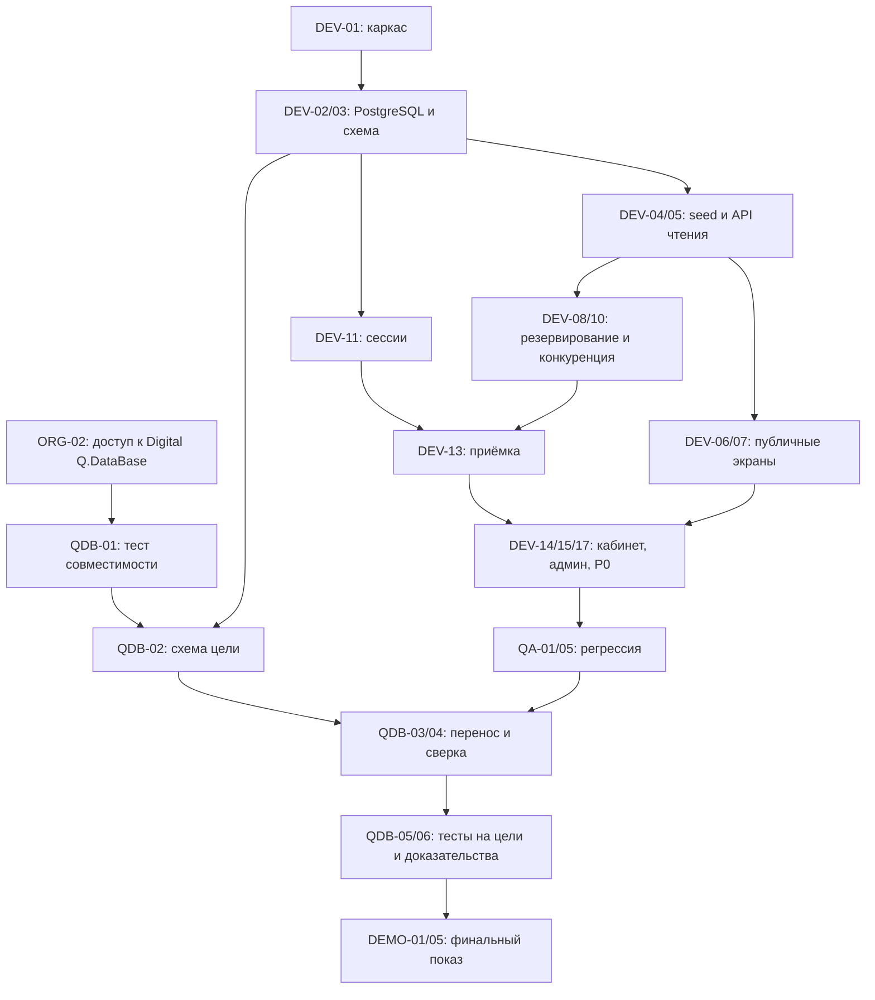

# Лапа рядом — план разработки MVP

**Документ:** `05_DEVELOPMENT_PLAN.md`  
**Версия:** 0.1 (рабочий план для разработчика и ИИ-агента)  
**Дата:** 21 октября 2026 года  
**Основание:** `00_PROJECT_CONCEPT.md`, `01_PRODUCT_REQUIREMENTS.md`, `02_USER_FLOWS.md`, `03_DATA_MODEL.md`, `04_TECHNICAL_ARCHITECTURE.md`  
**Цель:** довести проект от документации до проверенного веб-приложения на Digital Q.DataBase, с реальной миграцией с PostgreSQL и воспроизводимой демонстрацией.  
**Текущий статус:** план составлен; в рамках подготовки документа приложение, среда Digital Q.DataBase и миграция **не запускались и не проверялись**.

## 1. Цель и границы плана

**Результат:** на вымышленных данных работает сквозной процесс: представитель приюта создаёт потребность → посетитель без регистрации резервирует определённое количество помощи → получает секретный код → представитель принимает часть или всё обещанное → показатели «требуется / обещано / получено / свободно» корректно изменяются. После этого тот же код приложения и существующие исходные данные переносятся с PostgreSQL на **Digital Q.DataBase**, операции повторно проверяются на целевой базе.

Что обязательно к завершению (P0):

- Публичные каталоги приютов и потребностей, фильтры потребностей и карточки.
- Предложение помощи без регистрации и выдача секретного кода.
- Учёт резервов, подтверждений, частичных передач, отмен и истечения срока.
- Кабинет представителя приюта и базовые административные действия.
- Атомарные транзакции, проверка доступа, отсутствие повторных списаний/резервов.
- Настоящий источник PostgreSQL, целевая Digital Q.DataBase, **перенос существующих записей** и автоматическая сверка.
- Запуск в демосреде, проверенная демонстрационная последовательность и запасной видеоматериал.

**Вне MVP (не брать в задачи):** оплаты, контактные данные волонтёров, личные кабинеты волонтёров, переписка, карты и определение координат, поиск пропавших питомцев, доставка, мобильные приложения, загрузка пользовательских фотографий, внешние AI/API, сложный мониторинг, Kubernetes, оптимизация для большой нагрузки.

**Правило приоритета:** сначала безопасность данных и работа в Digital Q.DataBase; затем полный P0; затем визуальная полировка; P1 — только после выполнения всех блокирующих проверок. Нельзя объявлять готовность по красивому интерфейсу без работающей базы.

## 2. Внешние сроки и критические зависимости

По опубликованным условиям [конкурса Digital Q.DataBase](https://dbd.diasoft.ru/), приём проектов — **до 21.10.2026**, требуется миграция с другой СУБД, запуск системы и отправка короткого демо и описания на `dbd@diasoft.ru` с пометкой «Хакатон». Награждение в программе конференции **27.10.2026 в 18:40–18:55 (Москва)**. Указанное время относится ко **всему блоку награждения**, а не гарантирует отдельное выступление определённой продолжительности.

Поэтому действуют **два независимых потока**:

**Организационный поток, приоритет № 1, сегодня:**

1. Уточнить, подтверждено ли выступление Миланы организаторами и распространяется ли на неё обычный дедлайн конкурса.
2. Если требуется конкурсная заявка, выяснить допустимость отправки результата после опубликованного срока. Не представлять незавершённую реализацию как готовую.
3. Получить дистрибутив, лицензию/доступ, инструкцию и сведения об установленной версии Digital Q.DataBase; определить, где запустить реальный экземпляр.
4. Согласовать, нужны ли кроме веб-демо слайды, экранная запись, отправка исходного кода и доказательства миграции.

**Инженерный поток, начинается сразу и не зависит от ответа по формату выступления:**

1. Создать работающее приложение на PostgreSQL.
2. Параллельно проверить реальную доступность Digital Q.DataBase и её совместимость с `pg` и используемым SQL.
3. Перенести данные, выполнить регрессию на целевой СУБД.
4. Зафиксировать демосборку и подготовить подтверждающие материалы.

**Жёсткая внешняя зависимость:** без реально работающей Digital Q.DataBase невозможно считать выполненными задачи переноса и конечную приёмку. При блокировке фиксировать `BLOCKED`, причину и требуемое действие; не заменять целевую СУБД PostgreSQL, SQLite или моками при формулировке результата.

## 3. Правила работы ИИ-агента

Перед первой правкой агент должен прочитать все файлы `docs/00_...md`—`docs/05_...md`. `01_PRODUCT_REQUIREMENTS.md` задаёт бизнес-функции и приоритеты; `02_USER_FLOWS.md` — экраны; `03_DATA_MODEL.md` — схему и транзакции; `04_TECHNICAL_ARCHITECTURE.md` — стек, API, секреты и перенос. **Документы выше приоритетнее предположений агента.**

- Выполнять задачи **по одной законченной вертикальной части**, а не генерировать весь проект за один проход.
- До реализации задачи читать её входные требования и записывать, какой конкретный результат надо получить.
- После каждой задачи: запустить команды проверки, показать фактический результат и ошибки, зафиксировать краткий лог выполненного.
- Не подменять API локальными массивами/моками в итоговых P0-сценариях. Моки допустимы только для изолированных UI-тестов.
- Не делать неоговорённых изменений схемы данных, ролей, бизнес-правил и текстов пользовательских статусов. Если обнаружено противоречие между документами, остановить **только затронутую задачу**, описать конфликт и предложить минимальную правку в первоисточнике.
- Не включать в код и артефакты секреты, реальные пароли, реальные контакты добровольцев, строки подключений с паролями.
- Не утверждать «проверено на Digital Q.DataBase», пока тест действительно не выполнялся на установленном экземпляре с зафиксированной версией.
- На каждом устойчивом этапе делать отдельный Git-коммит; не смешивать рефакторинг несвязанных модулей.
- Не оставлять опасные обходы («временно без проверки роли», «сохранять код в открытом виде», «позже сделать транзакцию») даже ради демонстрации.

### Стандарт отчёта после задачи

```text
Задача: DEV-XX
Статус: DONE / PARTIAL / BLOCKED
Изменено: файлы / модули
Проверено: команды, фактические результаты (PASS/FAIL)
Осталось: конкретные проблемы и ограничения
Следующая задача: DEV-YY
Коммит: <hash>, если применимо
```

Ведётся `docs/IMPLEMENTATION_STATUS.md` как **рабочий журнал разработки**. Это служебный файл, он не заменяет ни один из восьми проектных документов. Указанные в плане названия скриптов — целевой контракт; фактические команды надо реализовать и задокументировать в `README.md`.

## 4. Технологии и устройство репозитория

Технологии не выбирать заново:

- `apps/web`: React + TypeScript + Vite + React Router, обычный CSS/CSS Modules.
- `apps/api`: Node.js 24 LTS + TypeScript + Fastify + Zod + `pg`.
- `db/migrations`: версионированные SQL-файлы `001_initial.sql`, `002_auth_sessions.sql`.
- `db/seed`: воспроизводимые вымышленные данные.
- `scripts`: применение миграций, seed, перенос и верификация.
- `tests`: интеграционные, конкурентные и e2e-тесты (Vitest/Playwright).
- `infra/compose.postgres.yml`: локальный источник PostgreSQL.

Не добавлять ORM, Redis, очереди сообщений, микросервисы и дополнительные внешние инфраструктурные зависимости без отдельного обоснования. SQL должен оставаться прозрачным и проверяемым на обеих СУБД.

**Единые правила БД:** 5 предметных таблиц `shelters`, `accounts`, `needs`, `offers`, `deliveries`, техническая `auth_sessions`, служебная `schema_migrations`, представление `need_balances`. UUID генерирует приложение. База не хранит пароль сотрудника, секретный код посетителя или cookie-сессию в открытом виде.

## 5. Маршрут разработки: этапы и контрольные точки

| Этап | Задачи | Выход / контрольная точка | Блокирует |
|---|---|---|---|
| 0. Организация и доступ | ORG-01—03 | Понятен статус выступления; есть задача на получение Digital Q.DataBase | Миграцию и конкурсное подтверждение |
| 1. Каркас, БД и проверка цели | DEV-01—04, QDB-01 | Приложение и PostgreSQL запускаются; выполнена начальная проба Digital Q.DataBase либо оформлен `BLOCKED` | Все последующие этапы |
| 2. Публичное чтение | DEV-05—07 | Каталоги и фильтры читают данные из PostgreSQL | Создание пользовательского предложения |
| 3. Резервирование | DEV-08—10 | Секретные коды, идемпотентность, корректные остатки | Сквозной сценарий |
| 4. Авторизация, приют, админ | DEV-11—17 | Роли и приёмка работают через API и интерфейс | Полный P0, полноценную регрессию |
| 5. Тестирование | QA-01—05 | P0-прогоны, конкурентные тесты, безопасность | Финальную миграцию и приёмку |
| 6. Реальная миграция | QDB-02—06 | Данные скопированы и проверены на Digital Q.DataBase | Заявление о миграции |
| 7. Показ и релиз | DEMO-01—05 | Фиксированная сборка, инструкция, репетиция | Выступление |

Детальный список задач ниже. **QDB-01 начинается параллельно DEV-01**, а не после завершения всего UI.

## 6. Этап 0 — организационные задачи

### ORG-01. Подтвердить формат участия Миланы (критический блокер по срокам)

- **Действие:** проверить договорённость, статус конкурсной заявки, действующий дедлайн, предполагаемую длительность выступления и допустимый формат показа.
- **Выход:** короткая запись подтверждённых сведений в `docs/IMPLEMENTATION_STATUS.md`; отсутствие ответа помечается как `UNCONFIRMED`, а не как согласие.
- **Готово, если:** известен контакт ответственного и имеются проверяемые условия дальнейшей подготовки.

### ORG-02. Получить Digital Q.DataBase и проверить право использования

- **Действие:** получить официальный дистрибутив или доступ к экземпляру, лицензионные условия, поддерживаемую ОС, реквизиты подключения и средства администрирования.
- **Выход:** версия/сборка, среда запуска, инструкция подключения **без публикации логина/пароля**.
- **Готово, если:** реальный экземпляр доступен для проведения тестов. Если пока недоступен — `BLOCKED`, инженерный трек продолжается на PostgreSQL.

### ORG-03. Уточнить состав сдаваемых артефактов

- **Действие:** выяснить, ожидаются ли ссылка на стенд, репозиторий, запись экрана, описание миграции, презентация.
- **Выход:** перечень результатов и адресат, зафиксированные в `IMPLEMENTATION_STATUS.md`.
- **Готово, если:** не осталось неопределённости, которая мешает направить допустимую заявку.

## 7. Этап 1 — каркас и базовая среда

### DEV-01. Создать репозиторий и команды проекта

**Зависимости:** документация 00–05. **Приоритет:** P0.

- Структура из §4 документа 04; `apps/web`, `apps/api`, `db`, `scripts`, `tests`, `infra`, `docs`.
- Рабочие `npm ci`, `npm run dev`, `npm run build`, `npm run test` (на первом шаге тест может быть smoke-тестом).
- `.gitignore`, `.env.example`, корневой `README.md`; никаких секретов в Git.
- TypeScript, lint/типизация (использовать минимальный совместимый инструментарий), Vite proxy для `/api`.
- `GET /api/v1/health` показывает, что API доступен; отдельная проверка БД должна отличаться от доступности самого HTTP-сервера.

**Приёмка:** фронтенд и API стартуют; один тест проходит; `git status` не показывает секретов; команды повторяемы после чистой установки зависимостей.

### DEV-02. Поднять исходный PostgreSQL

**Зависимости:** DEV-01. **P0.**

- Сервис в `infra/compose.postgres.yml` с именованным томом, портом только для локального использования.
- Конфигурация `DATABASE_URL`, пул соединений и тайм-ауты.
- Обязательный smoke `SELECT 1` на PostgreSQL; понятное сообщение об ошибке подключения без раскрытия URI.

**Приёмка:** `db:up` создаёт источник; API отвечает реальными результатами SQL; данные переживают перезапуск контейнера.

### DEV-03. Создать схему и исполнителя миграций

**Зависимости:** DEV-02. **P0.**

- `db/migrations/001_initial.sql` строго на основе SQL и представления `need_balances` из документа 03.
- `db/migrations/002_auth_sessions.sql` на основе документа 04.
- Служебный учёт `schema_migrations` с версией и контрольной суммой; изменение уже применённого файла обнаруживается как ошибка.
- Транзакционное применение миграции, если версия СУБД поддерживает необходимую семантику; при несовместимости не скрывать частичное состояние, а документировать восстановление.
- Запрет на `DROP ... CASCADE` по умолчанию при обычном запуске.

**Приёмка:** чистая БД создаётся одной командой; повторное применение — без побочных изменений; таблицы, индексы, `FK`, `UNIQUE`, `CHECK`, view существуют; ошибочная миграция не маскируется «успехом».

### DEV-04. Создать seed и управляемый reset

**Зависимости:** DEV-03. **P0.**

- Три **вымышленных** приюта, 8–12 потребностей в разных категориях и населённых пунктах; 1 admin и по 1 представителю каждого приюта.
- Состояния: доступная помощь, частично обещанная, полученная и пустая по остаткам.
- Демопароли передаются через переменные окружения и хешируются Argon2id.
- Seed детерминированный в пределах сценария, повторный запуск не создаёт дубликатов; не переписывает вручную созданную работу без явного сброса.
- `reset-demo` разрешён только в явно указанном `APP_MODE` и **только для специально выделенной демобазы**, с дополнительным подтверждением идентификатора целевой среды. Не использовать его как команду очистки боевой СУБД.

**Приёмка:** после seed каталоги получают осмысленные данные из БД; текст «Демонстрационный проект. Приюты и заявки вымышлены» запланирован в интерфейсе; reset не срабатывает на незнакомом подключении.

### QDB-01. Ранний тест доступности Digital Q.DataBase (параллельно DEV-01—04)

**Зависимости:** ORG-02. **P0, критический внешний риск.**

- Зафиксировать реальную версию/сборку и тип установленной СУБД.
- Проверить `pg` и соединение, параметризованные запросы, `UUID`, `BYTEA`, `TIMESTAMPTZ`, `CHECK`, `UNIQUE`, `FOR UPDATE`, транзакции, представление `need_balances` на отдельной тестовой схеме.
- Проверить работу DDL из DEV-03, при несовместимости составить конкретный минимальный патч/отчёт, не придумывая поддержку автоматически.

**Приёмка:** протокол с PASS/FAIL по каждому пункту, реальное подключение и скриншот/вывод идентификации продукта без секретов. `SELECT 1` в одиночку не означает завершение QDB-01.

## 8. Этап 2 — публичный каталог и чтение из БД

### DEV-05. Репозитории и публичный API

**Зависимости:** DEV-03/04. **P0.**

- Реализовать маршруты чтения `GET /api/v1/shelters`, `/shelters/:id`, `/needs`, `/needs/:id` согласно документу 04.
- Публично возвращать только опубликованные приюты и открытые потребности.
- Фильтры потребностей: категория, населённый пункт, строка поиска; серверные лимиты длины и объёма выдачи.
- Остатки считать из `need_balances`, не дублировать числовые счётчики в `needs`.
- Возвращать только публичные поля, не отдавать хеши и сведения сотрудников.

**Приёмка:** API-проверки показывают, что скрытый приют и его потребности отсутствуют, а четыре показателя совпадают с SQL для тестовых данных; есть ответы для пустых выборок и 404.

### DEV-06. Публичные экраны и навигация

**Зависимости:** DEV-05. **P0.**

- `/` → главная либо редирект на `/needs`; `/needs`, `/needs/:needId`, `/shelters`, `/shelters/:shelterId`.
- Адаптивные карточки; категории и единицы на русском языке; видимые «требуется / обещано / получено / свободно».
- Состояния loading/empty/error, доступная навигация с клавиатуры, читаемые кнопки и подписи.
- На всех публичных экранах заметная пометка о вымышленных приютах.

**Приёмка:** страницы работают с реальным API и после обновления по прямому URL; каталог адекватно читается на узком экране; нет ложных обещаний о приёме помощи.

### DEV-07. Фильтры и состояния остатков

**Зависимости:** DEV-06. **P0.**

- Поиск, фильтры и сброс фильтров для потребностей, корректные пустые состояния.
- Кнопка предложения доступна лишь при активной потребности с `available_qty > 0`; окончательное решение всё равно принимает сервер.
- «Всё необходимое уже обещано или получено» при нулевом остатке.

**Приёмка:** фильтры реально изменяют список; не создают несуществующие записи; UI правильно отображает нулевой остаток.

## 9. Этап 3 — предложение помощи без регистрации

### DEV-08. Транзакционное создание предложения

**Зависимости:** DEV-03, DEV-05. **P0, критическая бизнес-операция.**

- `POST /api/v1/offers` по документу 04; количество — целое положительное, не выше свободного остатка.
- `idempotencyKey` — UUIDv4 одной клиентской попытки; повтор с тем же телом возвращает прежнее предложение, повтор с изменёнными полями — `409`.
- Код `XXXXX-XXXXX-XXXXX-XXXXX` по HMAC-SHA256 из документа 03/04; в таблице только `code_hash`, в логах/URL секретного кода нет.
- Одна транзакция, один `client`, блокировки **`shelters → needs`** и проверка после блокировок.
- Срок резервирования 7 × 24 часа, актуальность определяется серверным временем.

**Приёмка:** API создаёт реальный резерв; активное обещание уменьшает свободное количество, но не увеличивает полученное; после повторного POST существует ровно одна запись; при конфликте возвращается актуальный остаток.

### DEV-09. Форма предложения и экран кода

**Зависимости:** DEV-08, DEV-06. **P0.**

- Форма количества на странице потребности, проверка целого числа и актуального максимума.
- `idempotencyKey` удерживается при повторной попытке после сетевого сбоя, но для независимого предложения создаётся новый.
- `/offer/result`: код, количество, приют, адрес, часы приёма и срок действия.
- Код не сохраняется в `localStorage`, адресной строке или аналитике; экран результата не утверждает успех до `COMMIT` на сервере.
- Кнопку «Копировать» реализовать, если позволяет среда (P1); минимум — выделяемая строка и чёткое предупреждение сохранить код.

**Приёмка:** посетитель без аккаунта создаёт предложение; после подтверждения видит код; повторное нажатие/повтор запроса не создаёт дубль.

### DEV-10. Истечение и конкурирующие предложения

**Зависимости:** DEV-08. **P0.**

- Просроченное `reserved` не учитывается в `reserved_qty` даже без фонового процесса.
- Невозможно создать предложение для закрытой/исполненной потребности или скрытого приюта.
- Два одновременных предложения на последние N единиц не создают переполнение.
- Отдельно проверить выдачу исходного кода при идемпотентном повторе (при неизменном `SERVER_OFFER_SECRET`).

**Приёмка:** проходят AT-03, AT-07, AT-08 из документа 04 и тесты бизнес-правил BR-05—07; фактические тесты на PostgreSQL.

## 10. Этап 4 — авторизация, приёмка и администрирование

### DEV-11. Сессии и проверка прав

**Зависимости:** DEV-03/04. **P0.**

- Вход/выход, `GET /auth/me`, Argon2id, `auth_sessions` с хешем случайного 32-байтового идентификатора.
- Cookie `HttpOnly`, `SameSite=Lax`, `Secure` для HTTPS; серверная проверка действительности и роли.
- На мутациях защищённой зоны Origin/Referer и `X-CSRF-Token`.
- Сотрудник приюта получает свой `shelter_id` только из БД; администратор имеет отдельный контекст.
- Защита от перебора паролей и кодов, нейтральные сообщения о неудачном входе.

**Приёмка:** чужой доступ 403/404, отсутствие сессии 401, logout отзывает сеанс; токены и пароль не появляются в логах/API.

### DEV-12. API управления потребностями приюта

**Зависимости:** DEV-11, DEV-05. **P0.**

- `GET /shelter/needs`, `POST /shelter/needs`, `PATCH /shelter/needs/:id`, `POST /shelter/needs/:id/close`.
- Поля и ограничения из FR-020—027 и документа 03; изменять единицу после создания запрещено.
- При уменьшении `target_qty` учитывать сумму уже полученного и **активно** обещанного.
- Закрывать потребность и отменять резервы одной транзакцией; закрытую/исполненную не возвращать в `active` из UI.

**Приёмка:** изменение не нарушает инварианты; представитель A не управляет объектами B; закрытая потребность недоступна для новых предложений.

### DEV-13. API поиска кода и подтверждения приёмки

**Зависимости:** DEV-08, DEV-11. **P0.**

- `POST /shelter/offers/lookup`, `POST /shelter/receive`, `POST /shelter/offers/:id/cancel`.
- Поиск по SHA-256 от нормализованного кода; не передавать код в URL или журнал.
- Подтверждать только действующее предложение своего приюта и количество от 1 до обещанного.
- `INSERT deliveries` + перевод `offers` в `received` + пересчёт статуса `needs` в одной транзакции.
- **Частичная приёмка:** обещано 5, получено 3 ⇒ остальные 2 немедленно снова свободны.
- Повтор подтверждения возвращает конфликт; `UNIQUE (deliveries.offer_id)` страхует от двойной записи.

**Приёмка:** AT-04—07, AT-09; одна доставка на предложение; при повторе полученное количество не меняется; истекший код отвергается.

### DEV-14. Кабинет представителя приюта

**Зависимости:** DEV-11—13. **P0.**

- `/login`, `/shelter`, `/shelter/needs/new`, `/shelter/needs/:id/edit`, `/shelter/receive`.
- Тексты на русском, полные формы и корректные предупреждения; после сохранения — актуальные данные.
- В приёмке по коду видно название потребности, обещанное количество и допустимый диапазон подтверждения.
- Изменение/закрытие только собственных потребностей; ошибки из API не скрываются.

**Приёмка:** сотрудник входит, создаёт потребность, принимает 3 из 5 и видит обновлённые показатели без ручного SQL.

### DEV-15. API и кабинет администратора

**Зависимости:** DEV-11. **P0.**

- `GET/POST /admin/shelters`, `PATCH /admin/shelters/:id`, `POST /admin/shelters/:id/publish`, `POST /admin/accounts`.
- `/admin`, `/admin/shelters/new`, `/admin/shelters/:id`, `/admin/access`.
- Без саморегистрации приютов; назначение представителя только администратором; хранение только хеша пароля.
- Администратор не может выполнить действие под чужой ролью без предусмотренного полномочия; разграничение на уровне API.

**Приёмка:** новый вымышленный приют до публикации невидим, после публикации видим; представитель привязан только к назначенному приюту.

### DEV-16. Согласовать состояния и единый слой ошибок

**Зависимости:** DEV-09, DEV-14, DEV-15. **P0.**

- Загрузка, пустой список, ошибки сети, `409`, `401`, `403/404`, истечение, повторная операция.
- Тексты для состояний `reserved`, `received`, `expired`, `cancelled` и `active`, `fulfilled`, `closed`.
- Не отображать «успешно» при ошибке; на `409` при резервировании обновлять остаток.

**Приёмка:** вручную воспроизведены все основные отказные сценарии; UI объясняет дальнейшее действие без технических трассировок.

### DEV-17. Полный сквозной проход и исправление интеграционных дефектов

**Зависимости:** DEV-05—16. **P0.**

- Пройти путь Миланы от входа сотрудника и создания потребности до публичного предложения и подтверждения передачи.
- Убедиться, что вся информация берётся из БД; обновление страницы и рестарт API не стирают предметные данные.
- Исправить только ошибки, влияющие на P0 и предстоящую миграцию, без добавления новых модулей.

**Приёмка:** AC-01—07 проходят в исходном контуре PostgreSQL.

## 11. Этап 5 — проверка качества и безопасности

### QA-01. Unit и интеграционные тесты

- Покрыть валидацию, расчёты, разрешённые переходы состояний, идемпотентность, авторизацию и ответы API.
- Интеграционные проверки выполняются с **реальным PostgreSQL**, не SQLite и не mock-репозиторием.
- Нельзя считать прохождение unit-тестов доказательством корректности SQL-транзакций.

**Приёмка:** `npm run test` PASS; отчёт содержит фактические проверки и обнаруженные ограничения.

### QA-02. Конкурентность и повторные вызовы

- Два запроса на последний доступный остаток.
- Повторный POST с одним `idempotencyKey`; повтор с изменённым телом.
- Два повторных подтверждения приёмки.
- Соревнование изменения цели, закрытия приюта/потребности и создания предложения.

**Приёмка:** нет отрицательного свободного остатка; нет повторных записей `deliveries` по одному предложению; результаты зафиксированы автоматическими тестами, а не только ручным кликом.

### QA-03. Безопасность и работа с секретами

- Публичный API не меняет приюты/потребности; представители изолированы по приюту.
- Сервер отвергает неверные/просроченные сессии и изменяющие запросы без CSRF-защиты.
- Пароли и коды не хранятся в открытом виде и не выводятся в логи/URL.
- SQL параметризован, ввод валидируется, rate limiting работает.
- Нет секретов в `git diff`, репозитории, скриншотах.

**Приёмка:** все критические случаи проверены; неисправности безопасности блокируют выпуск.

### QA-04. Публичный UX и мобильный экран

- Тексты на русском, разборчивость на телефоне, keyboard navigation и базовая доступность форм.
- Прямые ссылки после обновления страницы, состояние пустых каталогов, ошибки сети.
- Демопредупреждение про вымышленные данные всегда видно.

**Приёмка:** нет ошибок, мешающих выполнить основной сценарий с мышью/клавиатурой; скриншоты основных экранов сохранены.

### QA-05. Регрессионная матрица

- Составить матрицу **FR-001—FR-032** → API/UI → автоматический или ручной тест, а также `AC-01—AC-08`, `AT-01—AT-12`.
- Все P0 пометить PASS/FAIL/BLOCKED с доказательством, P1 — отдельно.
- Подробные тест-кейсы оформить в `06_TEST_PLAN.md`.

**Приёмка:** нет P0 со статусом «неизвестно», который выдаётся за выполненный.

## 12. Этап 6 — миграция на Digital Q.DataBase

### QDB-02. Подготовить целевую схему

**Зависимости:** QDB-01, DEV-03. **P0.**

- Создать отдельную пустую целевую БД; убедиться, что она не содержит чужих данных.
- Применить реальные миграции `001_initial.sql`, `002_auth_sessions.sql`, проверить `schema_migrations` и `need_balances`.
- Несовместимости устранять минимальным документированным изменением; повторно проверять PostgreSQL.

**Приёмка:** вся схема существует именно в Digital Q.DataBase; факты установки и версия сохранены в отчёте без секретов.

### QDB-03. Реализовать копирование данных

**Зависимости:** QDB-02, DEV-17. **P0.**

- `scripts/migrate-data.ts`: отдельные подключения `SOURCE_DATABASE_URL` и `TARGET_DATABASE_URL`.
- Зафиксировать запись в исходную БД на время экспорта; сохранить резервную копию.
- Копировать **существующие строки**, а не запускать заново `seed-demo.ts` на цели.
- Порядок: `shelters → accounts → needs → offers → deliveries`; переносить UUID, FK, байтовые хеши, временные поля и статусы без переинтерпретации.
- **Не копировать** `auth_sessions`, аутентификацию после переключения начать заново; `schema_migrations` формируется применением схемы.
- Выполнять вставки в целевой транзакции; при ошибке откатить весь перенос. Повтор возможен только в явно подтверждённую чистую целевую среду.

**Приёмка:** копирование завершилось без ошибок; целевые UUID совпадают с источником; без ручного исправления строк и вставки «примерно таких же» данных.

### QDB-04. Верифицировать миграцию

**Зависимости:** QDB-03. **P0.**

- `scripts/verify-migration.ts` сравнивает количество строк в пяти предметных таблицах, множества ID, FK, значения и распределение статусов, `code_hash` и `idempotency_key`.
- Сравнить суммы `received_qty`, активных резервов и свободного остатка **на одном фиксированном UTC-моменте**.
- Убедиться, что нет сирот и дублей, `available_qty >= 0`, нет ошибок ссылочной целостности.
- Подготовить отчёт `migration-report.md` с версией источника и цели, результатами всех проверок и описанием исправлений совместимости.

**Приёмка:** `npm run db:verify` даёт PASS **по всем** обязательным инвариантам, отчёт воспроизводим. Неполная сверка — не PASS.

### QDB-05. Переключить API и повторить критические тесты

**Зависимости:** QDB-04, QA-01—03. **P0.**

- Сохранить `SERVER_OFFER_SECRET` и конфигурацию кода; поменять `DATABASE_URL` на реальную Digital Q.DataBase.
- Перезапустить API, повторно войти сотрудниками (сессии не переносились).
- Повторить на цели как минимум: создание предложения, частичную приёмку, повторное подтверждение, истечение, гонку двух заявок, запрет чужого доступа и полный путь UX.
- Не менять логику в зависимости от названия БД; при выявлении несовместимости устранить и вернуться к нужной регрессии.

**Приёмка:** AC-01—08 и критические AT-02, 05—08, 11—12 PASS на целевой СУБД. Сохранены реальные результаты выполнения.

### QDB-06. Сохранить доказательства миграции

**Зависимости:** QDB-05. **P0.**

- Вывод проверки версии/сборки Digital Q.DataBase и способа развёртывания.
- Скрипт переноса и отчёт сравнения; безопасные логи без URI с паролями.
- Короткая запись экрана из **живого** работающего приложения на целевой БД.
- Не называть демонстрацией миграции повторный seed в новой базе, переключение таблички в UI или запись заранее подготовленной анимации.

**Приёмка:** сторонний проверяющий может понять, что именно перенесено, как это проверено и на какой СУБД работает финальная версия.

## 13. Этап 7 — подготовка демонстрации

### DEMO-01. Подготовить стабильный демостенд

- Одна фиксированная сборка приложения, отдельная БД Digital Q.DataBase; никаких спонтанных обновлений зависимостей.
- Публичный интерфейс, кабинет приюта и доступ администратора проверены из демонстрационного браузера.
- Данные сбалансированы под сценарий (наглядный запрос с количеством 20, показ резерва 3/5 и подтверждения).

**Приёмка:** основной сценарий проходит после перезапуска стенда; не требует внешних карт, платежей или SMS.

### DEMO-02. Подготовить и проверить сценарий Миланы

- Одна история: запрос приюта → посетитель предлагает помощь → сохраняет код → приют подтверждает → изменения видны в цифрах.
- Коротко показать, что данные поступают из Digital Q.DataBase; название и статус миграции произносить **только если QDB-05/06 действительно PASS**.
- Для фактической продолжительности демонстрации использовать договорённость ORG-01, а не весь 15-минутный блок награждения.

**Приёмка:** Милана воспроизводит сценарий самостоятельно по `07_DEMO_AND_PITCH.md`.

### DEMO-03. Настроить безопасный повтор показа

- Сделать сценарий на нескольких заранее заведённых потребностях или процедуру **контролируемого** восстановления демосостояния.
- Никогда не чистить целевую БД без явного подтверждения назначения стенда.
- Подготовить краткий список тестовых логинов (пароли передаются отдельно, не в Git/слайдах).

**Приёмка:** после одной репетиции можно повторить показ, не редактируя вручную SQL на сцене.

### DEMO-04. Резервное видео и иллюстрации

- Записать короткий ролик экрана **после успешного подключения к целевой СУБД**.
- Подготовить несколько скриншотов и один экран со схемой «приют — помощь — БД — результат».
- Отделить видеорезерв от доказательств реальной работы.

**Приёмка:** локальная копия открывается без сети; секреты и административные сведения не попадают в кадр.

### DEMO-05. Финальная готовность

- Прогнать чек-лист оборудования и сети, открытие ссылок, экран браузера, масштаб текста, вход и повторную передачу.
- Сохранить тег релиза/коммит, версии компонентов, резервные данные и итоговый `migration-report.md`.
- Исправлять после фиксации только критические ошибки с обязательным повторным тестом; P1 не добавлять.

**Приёмка:** один конкретный проверенный билд, понятный порядок запуска, известные ограничения, сценарий и резервный материал.

## 14. Расстановка приоритетов и зависимости (кратко)



Три критические цепочки: **доступ к Digital Q.DataBase**, **транзакционный сценарий помощи**, **реальный перенос и регрессия**. Не откладывать ни одну из них ради оформления.

## 15. Календарные ориентиры до конференции

Это **целевые контрольные точки**, а не гарантия, что разработка завершится к указанным датам: они зависят от доступа к Digital Q.DataBase, состава команды и результатов тестов.

| Дата | Что проверить в первую очередь | Решение, если есть блокер |
|---|---|---|
| **21 октября, ср.** | Участие/дедлайн; доступ к Digital Q.DataBase; каркас и PostgreSQL, SQL-схема | Эскалировать организаторам вопрос доступа и формата; не выдавать проект за сданный |
| **22 октября, чт.** | Каталоги на реальной PostgreSQL, первые тесты целевой СУБД | Продолжать разработку, но держать QDB-01 в статусе риска |
| **23 октября, пт.** | Предложение, HMAC-код, идемпотентность, конкурентные тесты | Убирать второстепенные UI-улучшения |
| **24 октября, сб.** | Кабинет, приёмка, частичная передача, минимальный админ | Фокусировать работу на полном сквозном сценарии |
| **25 октября, вс.** | Регрессия PostgreSQL; перенос и сверка; тесты на целевой БД | Если цель недоступна — честно зафиксировать блокер, не заменять её моками |
| **26 октября, пн.** | Стабилизация, репетиция, резервная запись, отчёт миграции | Не расширять функциональность, не обновлять зависимости |
| **27 октября, вт.** | Проверка демонстрационного стенда и выступление | Использовать только фактически проверенные материалы и корректные формулировки |

**При выборе между сроками и достоверностью:** показывать конкретный доказанный результат и честно говорить об ограничениях. «Миграция выполнена» допустимо только при доказанном QDB-04/05.

## 16. Правила переключения с P0 на P1

**P0 завершён**, только когда полностью пройдены сценарии AC-01—08, проверки критических ошибок безопасности и доказательство работы на Digital Q.DataBase. После этого можно рассматривать P1 в таком порядке:

1. Копирование кода, просмотр статуса своего предложения.
2. История подтверждённых передач в кабинете приюта.
3. Дополнительная сортировка/фильтр каталога приютов.
4. Скрытие ранее опубликованного приюта с сохранением данных.

Любой P1 откладывается, если остаётся блокер по миграции, корректности количеств или безопасности. Не включать в этот спринт новую функциональность поиска пропавших животных.

## 17. Риски и стратегия действий

| Риск | Вероятное последствие | Действие |
|---|---|---|
| Целевая Digital Q.DataBase недоступна | Невозможно выполнить ключевую миграцию | Запросить доступ немедленно; вести отдельный `BLOCKED`; не создавать ложный отчёт |
| Несовместимость версии SQL/драйвера | Миграция или транзакции не проходят | Ранний QDB-01; минимальный патч с проверкой обеих СУБД |
| Дедлайн конкурса наступил до готовности | Заявку могут не принять | Согласовать с организаторами отдельный формат/условия; не обещать допуск |
| Одновременные предложения превышают остаток | Неверные данные и отсутствие доверия | Единый порядок блокировок и конкурентные тесты |
| Потерян ключ HMAC при переносе | Нельзя восстановить прежний код для идемпотентного повтора | Сохранить `SERVER_OFFER_SECRET` вне БД и репозитория, обеспечить надёжный доступ |
| Демо ломается из-за сети | Невозможность живого показа | Стенд на контролируемом окружении; резервное видео, помеченное как резерв |
| Не хватает времени на UI | Плохое восприятие проекта | Чистый минимальный дизайн, только P0-экраны, один наглядный сценарий |
| Утечка пароля/кода в кадре | Репутационные и технические риски | Тестовые секреты, скрытие их в логах/слайдах, отдельный браузерный профиль |

## 18. Финальный критерий готовности (release gate)

Отметить **PASS** только по факту исполнения, а не исходя из наличия кода:

- [ ] `npm ci`, `npm run build`, основные команды из документа 04 работают на чистой среде.
- [ ] Предметные данные в исходном PostgreSQL реальны для приложения (не моки).
- [ ] Все P0-сценарии пользователя, приюта и администратора пройдены.
- [ ] Нет повторной передачи или избыточного резерва при конкурентных запросах.
- [ ] Пароли, коды и cookie не хранятся открытым текстом; права приютов изолированы.
- [ ] В Digital Q.DataBase применена схема, записаны её фактическая версия и окружение.
- [ ] Существующие строки перенесены из PostgreSQL в Digital Q.DataBase, а не заново созданы через seed.
- [ ] Проверены ID, связи, статусы, bytea-хеши, значения и суммы; `migration-report.md` показывает PASS.
- [ ] Приложение реально подключено к Digital Q.DataBase, а сценарий предложения/подтверждения/конкуренции прошёл на ней.
- [ ] Стенд и сценарий Миланы воспроизводимы; есть запасная запись без раскрытия секретов.
- [ ] Известны и честно указаны ограничения; статус выступления/заявки отдельно подтверждён.

**Статусы выпуска:**

- `DESIGNED` — только документация.
- `SOURCE_READY` — всё P0 работает с PostgreSQL, но перенос ещё не доказан.
- `MIGRATED` — схема, данные и проверки успешны на Digital Q.DataBase.
- `DEMO_READY` — `MIGRATED` плюс полный прогон на стенде и подготовленные материалы.

Никакой статус выше `DESIGNED` **не присваивается подготовкой этого документа**.

## 19. Пакет передачи ИИ-агенту

**Стартовая инструкция:**

> Прочитай `docs/00_PROJECT_CONCEPT.md`—`docs/05_DEVELOPMENT_PLAN.md`. Реализуй MVP «Лапа рядом» строго по P0 и архитектуре. Начни с DEV-01, параллельно выясни готовность QDB-01. Каждую задачу выполняй как законченный проверяемый инкремент: код, запуск, тест, отчёт, коммит. Не создавай моки вместо предметной БД, не расширяй функциональность, не заявляй миграцию без фактического переноса и проверки. Записывай прогресс в `docs/IMPLEMENTATION_STATUS.md`, конфликты требований и блокеры формулируй явно. После каждого этапа показывай фактические PASS/FAIL и следующую задачу. В конце выдай инструкции запуска, результаты тестов на обеих СУБД и отчёт миграции без секретов.

**Стартовые артефакты:** шесть документов `00`—`05`; пустой или существующий репозиторий; сведения об окружении (ОС, Node.js, Docker); отдельные секреты доступа к БД. До получения последних не придумывать адреса и пароли.

**Ожидаемые конечные артефакты:** рабочий репозиторий, `.env.example`, инструкции запуска, `.sql`-миграции, seed, тесты, `migration-report.md`, подтверждение работоспособности на Digital Q.DataBase, журнал реализации и демонстрационный билд.

## 20. Источники и следующий документ

1. [Конференция и правила конкурса](https://dbd.diasoft.ru/) — дата, дедлайн, требование миграции, порядок сдачи и блок награждения (проверено 21.10.2026).
2. [Официальная документация Digital Q.DataBase 18.3](https://database.diasoft.ru/docs/ru/q-database/versiya-183/index/) — используемая проектом исходная документация; конкретную версию целевого экземпляра подтвердить на практике.
3. Внутренние документы `00_PROJECT_CONCEPT.md`—`04_TECHNICAL_ARCHITECTURE.md` — первоисточники требований и решений.

**Следующий документ:** `06_TEST_PLAN.md` — подробная матрица P0/P1, тестовые наборы, автоматизация, проверка миграции и шаблоны фиксации результатов.
